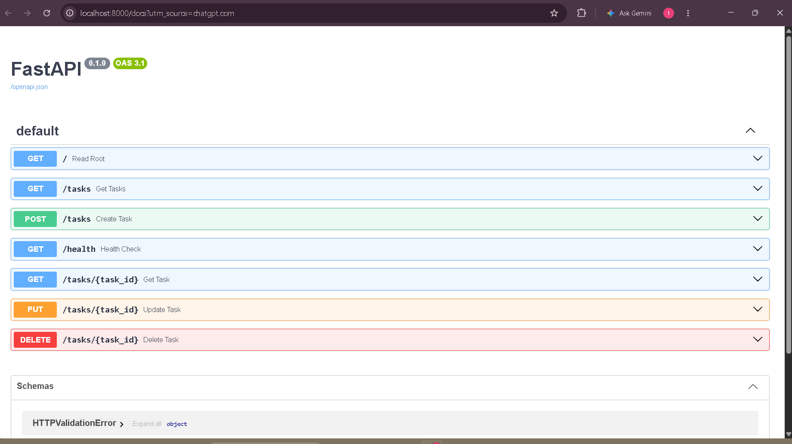

# CRUD Task API

A simple CRUD API built using Python and FastAPI.

The API allows users to create, read, update, and delete tasks. Tasks are stored in memory, so they will be lost when the server is restarted.

## Installation

Install the required dependencies:

```bash
pip install -r requirements.txt
```

## Run the API

Run the server using:

```bash
python -m uvicorn main:app --reload
```

The API will be available at:

http://localhost:8000

Swagger API documentation is available at:

http://localhost:8000/docs

## API Endpoints

| Method | Endpoint | Description |
|--------|----------|-------------|
| GET | `/` | Returns a Hello World response |
| GET | `/health` | Checks if the API is running |
| GET | `/tasks` | Returns all tasks |
| GET | `/tasks/{task_id}` | Returns a specific task |
| POST | `/tasks` | Creates a new task |
| PUT | `/tasks/{task_id}` | Updates a task |
| DELETE | `/tasks/{task_id}` | Deletes a task |

## Example curl Output

Example request:

```bash
curl.exe -i http://localhost:8000/
```

Example output:

```text
HTTP/1.1 200 OK
server: uvicorn
content-type: application/json

{"message":"Hello World"}
```

## Swagger UI

The API can be tested interactively using FastAPI's built-in Swagger UI.

